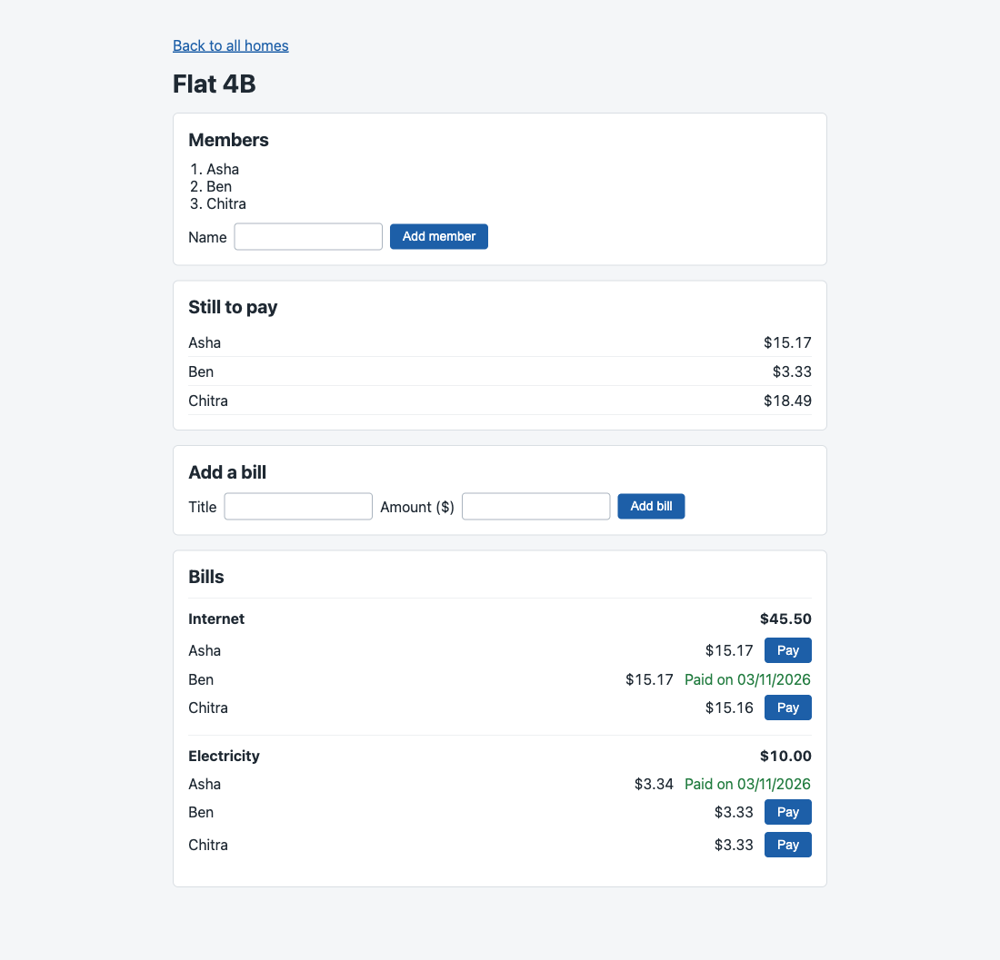
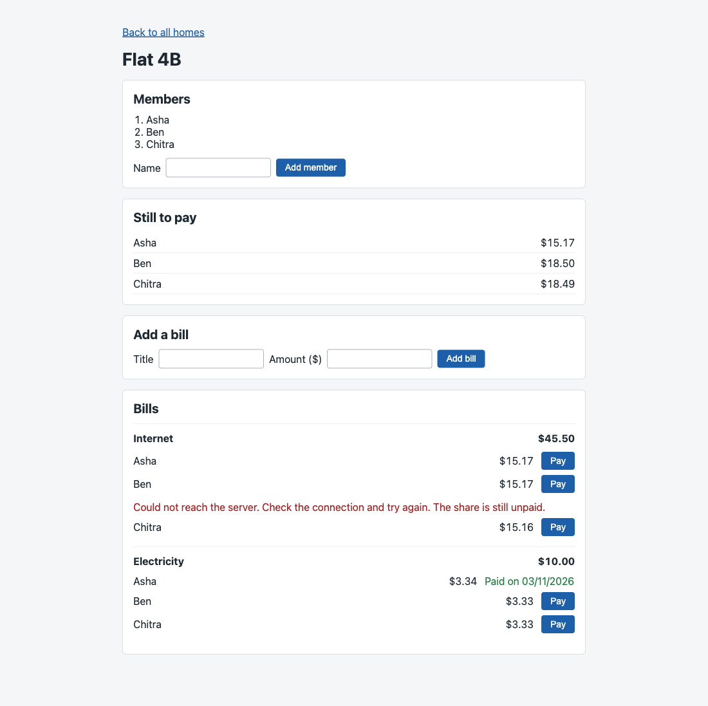

# SDE Intern Assignment: Shared Bill Splitter

Welcome. In this assignment you build a small bill splitter for a shared home. It has two parts:

1. **Homes and members:** create a home and add members to it.
2. **Bill splitting:** split a bill between the members. Each member pays their own share.

The assignment is small on purpose. We want correct, safe, and clear code. We do not want many features.

## What we look at

- **Your code passes the tests.** The tests decide, not opinion. You get the visible tests. We also run extra tests that you do not see.
- **Your code is safe when things go wrong.** Wrong input, repeated requests, and two requests at the same time must not break your data.
- **Your code is typed.** Use TypeScript. Do not use `any`.
- **You understand your code.** You record a short video and explain it.

Take your time. A careful, correct solution is better than a fast one. We expect 2 to 3 days of real work.

## Stack (required)

- **API:** Hono on Cloudflare Workers
- **Database:** Cloudflare D1 (SQLite). The binding is `DB` in `api/wrangler.jsonc`.
- **Web:** React, Vite, TanStack Router
- **Language:** TypeScript on both sides
- **Tests:** Vitest, running inside the Workers runtime
- **Quality:** Biome. `pnpm check` and `pnpm typecheck` must pass.

You choose the rest (styling, form library, validation library). Pick tools you can explain.

## The task

The assignment has two parts. Do Part 1 first. Part 2 builds on it.

**Database.** Write the schema as SQL migration files in `api/migrations/`. For example `0001_init.sql`. The tests apply every file in this folder. Your schema must have **at least 3 named constraints** that protect the data. For example a foreign key, a `CHECK`, or a `UNIQUE` key. Be ready to explain what each constraint stops.

**Errors.** Every error response is JSON: `{ "error": "message" }`.

## Part 1: Homes and members

Create a home and add members to it. The order in which members are added matters in Part 2.

#### `POST /api/homes`

- Request: `{ "name": string }`
- Success: `201` `{ id, name }`

#### `POST /api/homes/:homeId/members`

- Request: `{ "name": string }`
- Success: `201` `{ id, homeId, name }`
- Errors: `404` home not found

Visible tests: `api/test/homes.test.ts`.

## Part 2: Bill splitting

Add a bill to a home, split it between the members, and let each member pay their share.

All amounts are whole **cents** (integers). `100` cents is 1 dollar. Never use decimals for money.

#### `POST /api/homes/:homeId/bills`

- Request: `{ "title": string, "totalCents": number }`
- Success: `201` `{ id, homeId, title, totalCents, shares: [{ id, memberId, amountCents, paidAt: null }] }`
- Errors: `404` home not found. `422` total is not a positive whole number, or the home has no members.

#### `POST /api/bills/:billId/shares/:shareId/pay`

- Request: header `Idempotency-Key`
- Success: `200` `{ id, memberId, amountCents, paidAt }`
- Errors: `400` key missing. `404` bill or share not found. `409` share already paid with a different key.

#### `GET /api/homes/:homeId/balances`

- Success: `200` `{ balances: [{ memberId, name, outstandingCents }] }`
- Errors: `404` home not found

**Rules**

- **Split.** A bill is split between all members of the home. The shares always add up to `totalCents`. If the amount does not divide evenly, the extra cents go to the members one by one, in the order the members were added to the home. Example: 1000 cents between 3 members gives `334`, `333`, `333`.
- **Pay.** Paying marks one share as paid and sets `paidAt`. If the same `Idempotency-Key` is sent again for the same share, answer `200` with the same result. Do not pay twice. If two requests pay the same share at the same time, only one may succeed.
- **Balances.** `outstandingCents` is the sum of the member's unpaid shares, across all bills of the home. List the members in the order they were added.

Visible tests: `api/test/bills.test.ts` and `api/test/payments.test.ts`.

#### Web page

Build one page that:

- shows the bills of a home and the shares of each bill,
- lets a member pay a share,
- shows clear **loading**, **empty**, and **error** states,
- keeps the share unpaid and shows an error if the payment fails.

The page must not crash when the API answers with an error or is slow.

## Cases you must handle

You must handle these cases and talk about them in your video:

1. A home with no members.
2. An amount that is zero, negative, or not a whole number.
3. An amount that does not divide evenly.
4. The same payment request sent twice.
5. Two members paying the same share at the same time.
6. A bill or share that does not exist.
7. The API answers with a 500 error or is slow. The web page must not crash.

## Run it

This is a pnpm workspace. Install once at the root.

```bash
pnpm install
pnpm dev          # api on :8787 and web on :5173
```

Open http://localhost:5173. The starter page shows a title. `/api/health` returns `{ "status": "ok" }`.

```bash
pnpm test         # run the visible tests in api/test
pnpm check        # Biome: format and lint. Must pass.
pnpm check:fix    # fix what Biome can fix
pnpm typecheck    # tsc on both packages. Must pass.
pnpm build        # production build of the web app
```

`pnpm dev` applies your migrations to a local database before it starts the API.

If pnpm says some build scripts were ignored, run `pnpm approve-builds` and allow `esbuild` and `workerd`.

When you change `api/wrangler.jsonc`, refresh the `Env` types:

```bash
pnpm --filter bill-splitter-api cf-typegen
```

## Rules for the tests

- The visible tests are in `api/test`. They start with a failing result. Your job is to make them pass.
- Do **not** change the visible tests or `api/test/helpers.ts`. We compare them with the original.
- We run extra tests after you submit. They test the cases in "Cases you must handle" more closely.

## AI policy

You can use AI tools. Tell us which ones and where in your answers on the form.
You must understand every line you submit. We check this with your video and in a live call. "The AI wrote it" is not an answer.

## How to submit

1. Click **Use this template**, then **Create a new repository**. Make the repository **public**.
2. Build your solution in your new repository. Small, clear commits are welcome.
3. Update this README with a short section called **Decisions**. Write 3 decisions you made and why.
4. Record a video of **3 minutes or less** (Loom or unlisted YouTube). Show the architecture, the data flow, and one trade-off you made. Make sure anyone with the link can view it.
5. Paste the repository link and the video link in the application form.

We will run `pnpm install && pnpm check && pnpm typecheck && pnpm test` on your repository.

## Decisions

1. **A payment is a row in its own `payments` table, and `share_id` is its primary key.** I did not want to trust a check in code like "if the share is not paid yet, mark it paid", because two requests can both pass the check before either one writes. A primary key cannot be passed twice. To pay, the API runs `INSERT ... ON CONFLICT (share_id) DO NOTHING`, and then reads the share back with its payment. If the key saved in the payment is the one that came in the header, the answer is `200` with that payment. This is true for the request that paid, and also for the same request sent again. If the saved key is a different one, the answer is `409`. If the share is not found, the answer is `404`. The cost of this choice is one more table and a `LEFT JOIN` every time shares are read. In return, "paid" and "which key paid" cannot get out of step with each other.

2. **The order of the members is a number inside the home, set by the insert itself.** `members.join_no` is 0 for the first member, 1 for the second, and so on. The order matters because the first members get the extra cents. I did not use the time of creation, because two members can be added in the same millisecond. The `INSERT` counts the members of the home in a sub-select, so reading the count and writing the new row happen in one statement. Members cannot be removed in this app, so the count is always the next free number. `UNIQUE (home_id, join_no)` stops a clash if that ever changes.

3. **A bill and its shares are saved together, and some rules are repeated in the database.** `DB.batch()` saves the bill and every share as one transaction, so a bill without shares cannot exist. Money is whole cents everywhere. The cents are divided with `Math.floor(total / people)` for everybody, and the leftover cents go one each to the first people. The check on the incoming amount uses `Number.isSafeInteger`, which refuses 10.5, a string, `null` and a number too big to be exact. The database repeats this with `CHECK` rules. Each share also stores `home_id`, and two foreign keys compare it with the bill and with the member, so a share cannot connect a bill and a member from two different homes. What the database cannot check is that the shares add up to the total, because a `CHECK` in SQLite cannot look at other rows. That part is only in the code and in the tests.

## The 7 cases

1. **A home with no members.** The bill is refused with `422`. On the page, the Add bill button stays disabled until the home has a member.
2. **An amount that is zero, negative or not whole.** `422`. The page changes "25.50" to 2550 by cutting the text apart, not by multiplying a decimal number.
3. **An amount that does not divide evenly.** 1000 cents between 3 people gives 334, 333 and 333.
4. **The same payment sent twice.** The second one gets `200` and the same `paidAt`. Only one row exists in `payments`.
5. **Two requests paying the same share at the same time.** One request wins. If the keys are different, the other one gets `409`. If the key is the same, both get `200` with the same payment.
6. **A bill or share that does not exist.** `404`. This is also the answer when the share exists but belongs to another bill.
7. **The API answers with a 500 or is slow.** Every error comes as `{ "error": "..." }`, including a 500 and a route that does not exist. The page gives up on a request after 8 seconds and shows a message with a Try again button. A payment that fails leaves the share unpaid and shows the message under it.

## The page

`/` lists the homes and has a form for a new one. `/home/:homeId` is the main page. It shows the members, how much each member still has to pay, a form for a new bill, and the bills with their shares and a Pay button.

- After a payment the page asks the API for everything again. It does not change a share on the screen by itself, so the screen shows what the server has.
- A share gets its `Idempotency-Key` on the first click and keeps it until the payment works. Say the server records the payment but the answer never arrives. The next click sends the same key, the server answers with the payment it already has, and nothing is paid twice. The keys are only kept in memory, so reloading the page forgets them.
- The page needs three reads that the task does not list: `GET /api/homes`, `GET /api/homes/:homeId` and `GET /api/homes/:homeId/bills`. I added them.

## Files

```
api/migrations/0001_init.sql    the tables and their constraints
api/src/index.ts                puts the routes together, JSON for errors and unknown routes
api/src/routes/homes.ts         homes, members, bills, balances
api/src/routes/bills.ts         paying a share
api/src/http.ts                 reading and checking the input
api/src/cents.ts                dividing cents between people
api/test/rules.test.ts          my tests (the visible tests are not changed)
web/src/server.ts               calls to the API, with a time limit and readable errors
web/src/useAsync.ts             loading, failed and ready states
web/src/cents.ts                showing and reading money
web/src/routes/                 the two pages
```

## Tests

`pnpm test` runs 43 tests. 24 are the visible ones and 19 are mine in `api/test/rules.test.ts`. Mine cover: 5 cents between 7 people, 6 members added in the same moment, two requests paying together (different keys and the same key), the first key still working after another key was turned down, a share asked for through another bill, a key of 201 characters, a payment request with no key, home names that are empty, only spaces, a number, missing or too long, a body that is not JSON, a total of `2 ** 53`, a blank bill title, a route that does not exist, a home with no bills, and the order of bills and shares.

To check that the payment tests can really fail, I changed `DO NOTHING` to `DO UPDATE` in the payment `INSERT`, so the last request would overwrite the first. Five tests failed. I changed it back and all 43 pass.

I did not write automated tests for the page. I used it in a browser, and made these problems happen on purpose: a 500 when paying, an answer lost after the server had saved the payment, a request slower than the time limit, a 500 on loading, and an answer that was not JSON. The page showed a message each time and did not crash.

## Screenshots

The main page:



A payment whose answer was lost on the way back. The share still shows Pay and the page says it is unpaid. Pressing Pay again sends the same key:


